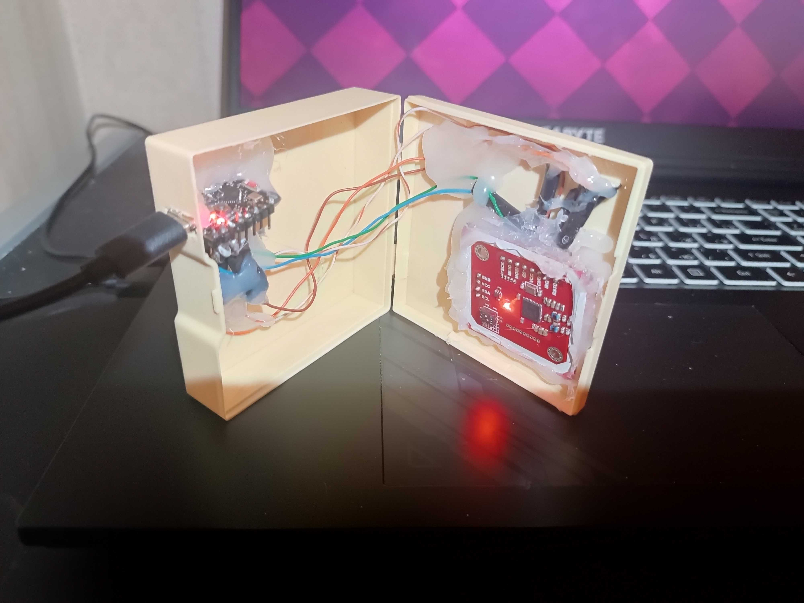
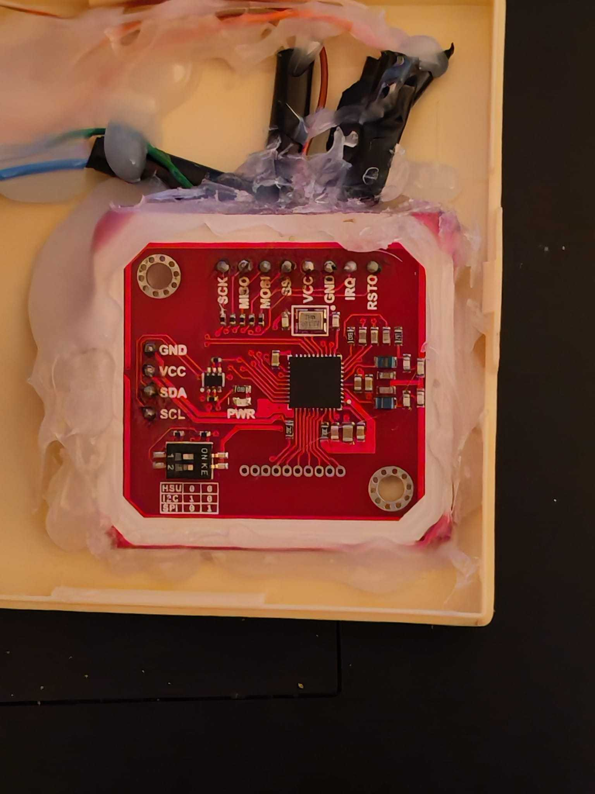

# contactless card image emulator
Piece of hardware and software designed to simulate contactless bank card behavior described in `CardImage` XML file. Card image is supposed to have `<Application>` tag in its XML in order to be loaded onto emulator. After uploading card image onto device the emulator is supposed to talk in EMV APDUs with the card reader / payment terminal over NFC in the same way as assumed physical contactless bank card with the same configuration.

Motivation: understand and reproduce terminal–card behaviour without relying on physical cards or expensive simulators.



[video_demonstration](res/video_demonstration.mp4)

General educational APDU / EMV walkthrough: [`res/theory.md`](res/theory.md)

# Setup and Usage
developed and verified on arch linux (rolling kernel 7.1.8-arch1-3), same steps should work on other linux distros given needed packages are installed.
To test it yourself you'd need:
1. linux environment with packages installed
2. hardware below soldered together and connected to the computer via USB cable
3. anything representing payment terminal or contactless bank card reader

## hardware
| Part | Approx. price | Link |
|------|---------|------|
| PN532 NFC RFID V3 | ~16$ | [Rozetka](https://rozetka.com.ua/ua/504646889/p504646889/) |
| ESP32‑C3 SuperMini | ~7$ | [Rozetka](https://rozetka.com.ua/ua/610213088/p610213088/) |
| USB type-C cable | ~7$ | [Rozetka](https://rozetka.com.ua/ua/ugreen_60826/p334028647/) |

connect pins between PN532 and ESP32:
| PN532 | ESP32 |
|---|---|
| SCK | GPIO 4 |
| MISO | GPIO 5 |
| MOSI | GPIO 6 |
| SS | GPIO 7 |
| VCC | 3V3 |
| GND | GND |

prefer careful soldering and immobilizing device with thermo-glue, loose contacts can cause PN532 not initializing (debugging this took a ton of time)

set SPI on PN532 by putting jumpers like in here: 

## environment preparation
before we start:
| Tool | Version |
|-------|----------------|
| `arduino-cli` | 1.4.1 (lower should work too) |
| python | 3.14.7 (3.10+ should work) |


```bash
# install and set up arduino-cli with your preferred package manager
sudo pacman -S arduino-cli
arduino-cli core update-index
arduino-cli core install esp32:esp32@3.3.11
arduino-cli lib install "Adafruit PN532"@1.3.4 "Adafruit BusIO"@1.17.4
# apply patch to Adafruit
cd ~/Arduino/libraries/Adafruit_PN532 # wherever you installed it
git apply /path/to/card_emulator/ADAFRUIT_PN532.patch
# prepare python environment
python3 -m venv .venv
.venv/bin/pip install pyserial
# optional
.venv/bin/pip install cryptography pycryptodome
export TMPDIR=/tmp
# ENV variables
export PORT=/dev/ttyACM0   # might differ
PY=.venv/bin/python
```

## compile and run
compile and flash:
```bash
arduino-cli compile --fqbn esp32:esp32:esp32c3:CDCOnBoot=cdc \
  --build-path build .
arduino-cli upload -p "$PORT" --fqbn esp32:esp32:esp32c3:CDCOnBoot=cdc \
  --input-dir build
```

listen for logs from device:
```bash
$PY configurer.py listen --port "$PORT"
```
make sure you see pn532 initialized logs

meanwhile in a second terminal:
```bash
# check xml file image correctness
$PY configurer.py parse --xml \
  "card_images/ResignedMasterCardContactlessOldVersionSubset8_PPC_MCD_01_V2.0.xml"
# put xml image onto device
$PY configurer.py read --port "$PORT" --xml \
  "card_images/ResignedMasterCardContactlessOldVersionSubset8_PPC_MCD_01_V2.0.xml"
# start simulating card image
$PY configurer.py write --port "$PORT"
```

# limitations
1. Max APDU size is 253 bytes, this is supposed to be enough for all payment cards (I didn't find any cards exceeding it, and terminals drop connections with sythesized cards that exceed it). If anything changes in future then software implementation of ISO-DEP chaining would be needed (earlier proved possible with a test prototype).
2. Supports card images of kind‑A only (root `CardImage` + ≥1 `<Application>`), magstripe-only/`EMVCoL3CardImage` are rejected.
3. other cardimage-related limits are imposed in code due to memory limitations on ESP32.


# TODO: explanations about re-signed images


If you ran into some issues by any chance or need to contact the developer, it would be great to receive your valuable feedback on email: *bilenko.a.uni@gmail.com*.

<div align="right">
<table><td>
<a href="#contactless-card-image-emulator">↥ Scroll to top</a>
</td></table>
</div>


